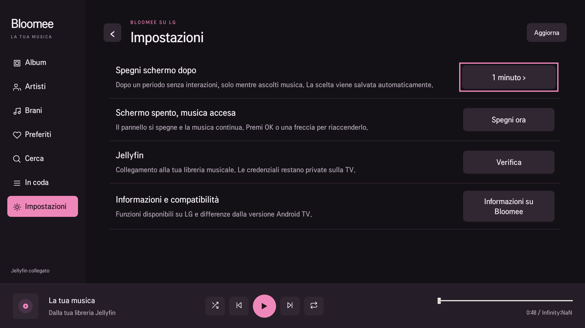

# Bloomee per LG webOS

Porting leggero di BloomeeTV per una LG con webOS 5 (Chrome 68), Homebrew Channel e root. L'app Android originale resta nel repository e conserva le proprie funzioni.

## Musica e telecomando

**Home** mostra le proposte di YouTube Music, con Novità e tendenze, Classifiche e Generi e mood. **Cerca** interroga insieme Jellyfin e YouTube Music; le sezioni di YouTube aprono l'elenco completo con Altri risultati. Le pagine artista di YouTube riportano ascoltatori mensili, iscritti, biografia e righe di brani, album, singoli, video e artisti simili; album e playlist hanno Ascolta, Casuale e In coda. **YouTube** raccoglie Per te, Cronologia, Mi piace, Playlist, Album e Artisti dell'account collegato.

Album, artisti, brani e preferiti del proprio Jellyfin; dettaglio album, coda mista Jellyfin/YouTube, casuale e ripetizione. Frecce e OK navigano nei controlli; nelle righe orizzontali destra e sinistra restano nella riga e dal bordo sinistro si torna al menu. Indietro riapre la pagina precedente, comprese quelle di artisti e album, e chiude le opzioni prima di lasciare la pagina.

In **Impostazioni → Spegni schermo dopo**, scegliere Mai, 15/30 secondi oppure 1/2/5 minuti. La preferenza resta salvata. Il timer vale solo durante l'ascolto senza interazioni. Sulla LG spegne il pannello tramite TV power, lasciando attivo l'audio; OK o una freccia lo riaccendono. Spegni ora applica lo stesso comando. Non viene mandato un comando di standby.

Su **Android TV**, la stessa preferenza è nelle impostazioni TV e viene salvata nel database. Le API pubbliche Android non consentono lo spegnimento fisico universale del pannello: si usa una vista nera con luminosità minima, mantenendo l'audio. La luminosità e i flag della finestra vengono ripristinati al risveglio e uscendo dall'app.

## YouTube Music

Catalogo, ricerca e riproduzione funzionano senza account. Il bridge usa lo stesso protocollo InnerTube del sito web e della versione Android TV per le pagine, e chiede l'audio con i client IOS e ANDROID_VR, che restituiscono flussi audio diretti. Si riproduce l'AAC; se la TV lo rifiuta, Bloomee riprova una volta con Opus. Gli URL di Google restano nel bridge: la pagina riceve solo l'ID del brano.

Per la libreria personale serve il proprio cookie di music.youtube.com, perché l'accesso Google non è possibile in un'app web webOS. Da un computer con l'accesso a music.youtube.com, aprire gli strumenti per sviluppatori, scheda Rete, selezionare una richiesta a `youtubei/v1` e copiare il valore dell'intestazione `cookie`. Sulla TV, come root:

```sh
cat > /var/lib/bloomee-webos/youtube.json <<'JSON'
{"cookie": "VALORE COPIATO"}
JSON
chmod 600 /var/lib/bloomee-webos/youtube.json
```

Per un account brand aggiungere `"dataSyncId"`, il valore `DATASYNC_ID` della pagina; `"visitorData"` è facoltativo. Il bridge firma le richieste con SAPISIDHASH e legge il file a ogni richiesta, senza riavvio; **Impostazioni → YouTube Music → Verifica** mostra il nome dell'account. Per scollegarsi cancellare il file. Il cookie dà accesso all'account Google: resta solo in quel file root 0600 e non va inserito nei sorgenti o nell'IPK. Mi piace e playlist non vengono scritti su YouTube.

Google può cambiare questi endpoint o chiedere la conferma "non sono un bot"; in quel caso il motivo compare nell'avviso e il brano non parte.

## Collegamento Jellyfin e privacy

Jellyfin è facoltativo: senza collegamento YouTube Music resta disponibile. Alla prima apertura il bridge importa, se presente, il collegamento privato di Cinema da `/var/lib/launch-home-cinema/jellyfin.json`. Altrimenti configurare `/var/lib/bloomee-webos/connection.json` come JSON con `server`, `userId` e `token`, proprietario root e permessi 0600. Non inserire credenziali nei sorgenti o nell'IPK.

Il bridge Python usa il token nell'header di autorizzazione sul server. Audio Jellyfin e YouTube e immagini Jellyfin passano da un proxy esclusivamente su 127.0.0.1, protetto da una capacità locale casuale. Il token del server non viene inserito nell'URL dei brani. La verifica TLS resta attiva. I moduli PSF di Python 2.7.18 inclusi servono sul runtime ridotto della LG e hanno licenza propria in PYTHON-LICENSE.txt.

## Build e test

```sh
cd webos
npm ci
npm test
npm run pack
```

Il pacchetto viene scritto in `release-webos/`. Per Android seguire le istruzioni del README principale. `restore.py`, eseguito come root sulla TV, riaccende il pannello, termina solo il bridge Bloomee e rimuove la sua copia privata della connessione e il cookie YouTube. Aggiornando l'app, un bridge di una versione precedente ancora attivo viene sostituito al primo avvio. Poi disinstallare Bloomee dal normale elenco app LG. Cinema e gli altri client restano installati.

## Differenze dalla versione Android

L'edizione LG usa Jellyfin e YouTube Music. Accesso Google dalla TV (si usa il file del cookie), Mi piace scritti sull'account, plugin Rust/Android e le loro classifiche, Lidarr, Cast, equalizzatore e download offline non sono implementati nel runtime webOS. Non si tratta dell'APK Android eseguito in una pagina web.

## Verifiche su LG

YouTube Music (0.2.0) non è ancora stato provato su una LG fisica. È stato verificato con il bridge in esecuzione su Python 2.7.18 e 3, ricerca, home, classifiche, artista e playlist reali, flusso audio con Range e salto nel brano in Chromium. Il desktop Chromium non ha AAC e ha usato il ripiego Opus; la libreria dell'account è coperta solo da test sulla firma delle richieste.

Versione 0.1.1:

Su 43UN70006LA con webOS 5: riproduzione Jellyfin readyState 4, nessun errore audio, tempo avanzato per 17 secondi durante il comando pannello spento, risveglio da freccia. Verificati album, artisti e brani, preferenza conservata dopo reinstallazione, navigazione del timer e uscita, accesso alle informazioni, ritorno al menu, assenza di overflow nelle righe delle impostazioni. I test remoti non sostituiscono una prova fisica di ogni tasto di ogni telecomando.


